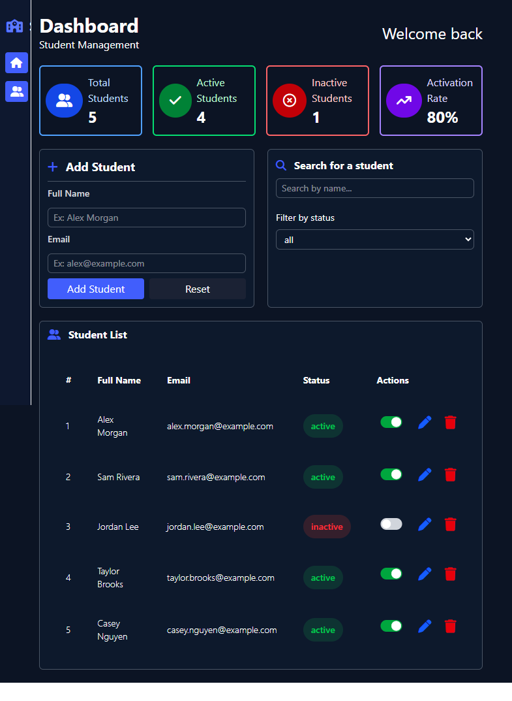
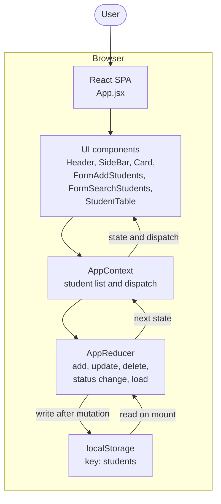
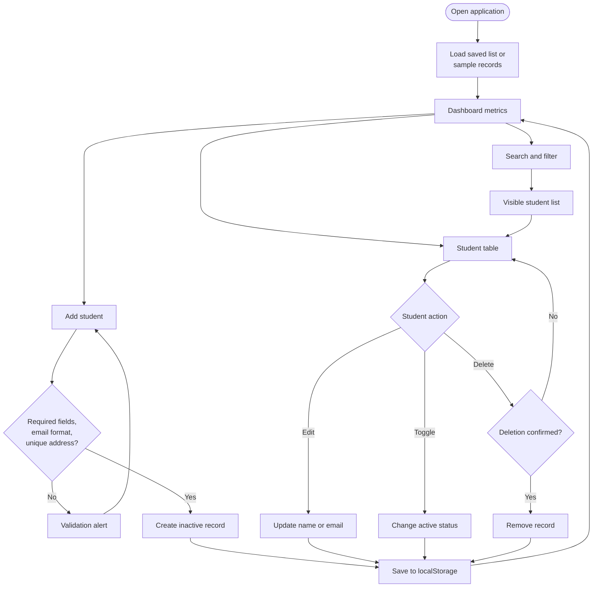

<div align="center">


<p><strong>A client-side student management dashboard built with React, Vite, and Tailwind CSS.</strong></p>

<p>Manage student records, search by name, filter by status, and track activation metrics from a single responsive interface.</p>

</div>

<div align="center">

<a href="https://github.com/mohammed-laabidi/react-students-manager"></a>
<a href="https://github.com/mohammed-laabidi/react-students-manager/fork"></a>
<a href="https://github.com/mohammed-laabidi/react-students-manager/issues"></a>


</div>

<div align="center">

<a href="https://mohammed-laabidi.github.io/react-students-manager/"><strong>Live Demo</strong></a>
&nbsp;&nbsp;|&nbsp;&nbsp;
<a href="https://github.com/mohammed-laabidi/react-students-manager">Repository</a>
&nbsp;&nbsp;|&nbsp;&nbsp;
<a href="https://github.com/mohammed-laabidi/react-students-manager/issues">Issues</a>

</div>

## Overview

React Student Manager is a single-page dashboard for maintaining a student roster. It combines a compact metrics overview with an editable table: each record stores a full name, an email address, and an active or inactive status. Users can add students, update their details, switch their status, remove records, and narrow the list with a name search and a status filter.

The application runs entirely in the browser. There is no backend, remote API, or external database. React Context and `useReducer` centralize state transitions, while the student list is serialized to `localStorage` so it survives a page reload. The interface is built with React 19, bundled by Vite 8, and styled with Tailwind CSS 4.

The dashboard is small in scope: one screen covers the complete workflow, from adding a record to reviewing activation metrics. Because all data stays in the browser, the project is suited to local use, demonstrations, and prototypes rather than multi-user production record keeping.

## Demo

<div align="center">



</div>

The live demo is available at **[mohammed-laabidi.github.io/react-students-manager](https://mohammed-laabidi.github.io/react-students-manager/)**.

The screenshot uses sample data. Try the full flow:

- Add a student with a valid email address.
- Toggle a student between active and inactive and watch the summary cards update.
- Search by name and combine the search with the status filter.
- Reload the page to confirm that the list is restored from `localStorage`.

No account or backend is required. Changes stay in the browser used to open the demo.

## Features

<table>
<tr>
<td width="50%" valign="top">


<h3>Dashboard metrics</h3>

<p>Four summary cards report total students, active students, inactive students, and the activation rate computed from the current list.</p>

</td>
<td width="50%" valign="top">


<h3>Student creation</h3>

<p>Add a student with a full name and email. Empty fields, malformed email addresses, and duplicate addresses are rejected before the record is created.</p>

</td>
</tr>
<tr>
<td width="50%" valign="top">


<h3>Inline editing</h3>

<p>Load an existing record into the form, update its name or email, and save the changes without leaving the dashboard.</p>

</td>
<td width="50%" valign="top">


<h3>Status control</h3>

<p>Switch any student between active and inactive directly from the table. The summary metrics update as soon as the status changes.</p>

</td>
</tr>
<tr>
<td width="50%" valign="top">


<h3>Search and filter</h3>

<p>Search by the beginning of a student's full name and combine the query with an all, active, or inactive status filter.</p>

</td>
<td width="50%" valign="top">


<h3>Local persistence</h3>

<p>Student records are written to browser <code>localStorage</code> under the <code>students</code> key and restored on the next visit.</p>

</td>
</tr>
<tr>
<td width="50%" valign="top">


<h3>Responsive layout</h3>

<p>Tailwind breakpoints rearrange the dashboard for smaller screens, and the sidebar collapses into a toggleable panel on mobile.</p>

</td>
<td width="50%" valign="top">


<h3>Predictable state</h3>

<p>A React Context provider exposes the student list and dispatch function. A reducer handles every add, update, delete, status change, and load action.</p>

</td>
</tr>
</table>

## Technology Stack

<div align="center">


</div>

| Technology | Purpose |
| --- | --- |
| React 19 | Component-based user interface and stateful views |
| Vite 8 | Development server, hot module replacement, and production build |
| Tailwind CSS 4 | Utility-first styling, including responsive breakpoints |
| JavaScript and JSX | Application logic and component markup |
| React Context and useReducer | Shared student state and predictable state transitions |
| Browser localStorage | Client-side persistence for the student list |
| Font Awesome 6 | Icon set loaded from a CDN in `index.html` |
| oxlint | Static analysis through `npm run lint` |
| npm | Dependency management and script runner |
| GitHub Pages and gh-pages | Static hosting and publishing of the production build |

## Architecture

The application is a static React single-page app. Components read the student list and dispatch actions through `AppContext`. `AppReducer` validates and transforms the list, then writes the result to `localStorage` using the `saveStorage` helper. On mount, a `getStudents` action restores any saved list; when no saved value exists, the provider starts with a small set of sample records.



There is no server-side layer to deploy or maintain. The only external runtime dependency is the Font Awesome stylesheet loaded from a CDN by `index.html`.

### Student record

| Field | Type | Description |
| --- | --- | --- |
| `id` | number | Incremental identifier derived from the last record in the list |
| `fullName` | string | Student display name |
| `email` | string | Email address validated on creation; duplicate addresses are rejected |
| `status` | active or inactive | Activation state; newly created records start as inactive |

## Application Flow



## Project Structure

```text
react-student-manager/
├── docs/
│   └── demo.png
├── public/
├── src/
│   ├── components/
│   │   ├── Card.jsx
│   │   ├── FormAddStudents.jsx
│   │   ├── FormSearchStudents.jsx
│   │   ├── Header.jsx
│   │   ├── Input.jsx
│   │   ├── SideBar.jsx
│   │   └── StudentTable.jsx
│   ├── Context/
│   │   └── AppContext.jsx
│   ├── Reducers/
│   │   └── AppReducer.jsx
│   ├── App.jsx
│   ├── colors.js
│   ├── main.jsx
│   ├── style.css
│   └── utils.js
├── index.html
├── package.json
├── vite.config.js
├── .oxlintrc.json
├── .gitignore
└── README.md
```

## Getting Started

### Prerequisites

- Node.js, preferably a current LTS release
- npm

No environment variables are required.

### Installation

```bash
git clone https://github.com/mohammed-laabidi/react-students-manager.git
cd react-students-manager
npm install
npm run dev
```

Vite prints the local development URL when the server starts.

### Production build

```bash
npm run build
npm run preview
```

The first command writes the optimized build to `dist/`. The second serves that build locally for verification.

### Available scripts

| Command | Description |
| --- | --- |
| `npm run dev` | Start the Vite development server with hot module replacement |
| `npm run build` | Create a production build in `dist/` |
| `npm run preview` | Serve the production build locally |
| `npm run lint` | Run oxlint across the project |
| `npm run deploy` | Build the project and publish `dist/` to the `gh-pages` branch |

The `predeploy` lifecycle script runs `npm run build` automatically before `npm run deploy`.

## Usage

### Dashboard

The four cards at the top of the page show the total number of students, the number of active students, the number of inactive students, and the activation rate. The rate is calculated as the integer percentage of active students in the current list, and it is reported as `0` when the list is empty.

### Add a student

1. Enter a full name and email address in the Add Student form.
2. Select Add Student.
3. The new record is appended with an incremented identifier and an inactive status.

The form rejects empty fields, invalid email formats, and email addresses that already exist in the list. Reset clears the form fields.

### Edit a student

1. Select the pen icon on the row to edit.
2. The form switches to Edit Student and is populated with the current name and email.
3. Change the values and select Save Changes.

### Change a student's status

Use the toggle in the Status column to switch a record between active and inactive. The status badge and the dashboard metrics update immediately.

### Search and filter

Type part of a student's name in the search field to match records by the beginning of their full name. Matching ignores case and surrounding whitespace. Use the status selector to show all records, only active records, or only inactive records. The search and status conditions can be combined.

### Delete a student

Select the trash icon on a row and confirm the browser prompt. The record is removed from the list and from `localStorage`.

### Persistence

Every mutation is serialized to `localStorage` under the `students` key. The app loads the saved list on startup and falls back to the initial sample records when no saved value is available. Clearing browser storage and reloading resets the application to that initial list.

## Deployment

The project is configured for static deployment to GitHub Pages.

- `vite.config.js` sets the production base path to `/react-students-manager/`, matching the GitHub Pages project URL.
- `npm run deploy` invokes the `gh-pages` package, which publishes the contents of `dist/` to the `gh-pages` branch.
- The published demo is available at [mohammed-laabidi.github.io/react-students-manager](https://mohammed-laabidi.github.io/react-students-manager/).

No server runtime, database, or environment variables are involved in the deployment.

## Security and Data Handling

- The application has no authentication or authorization layer. It is a client-side tool, not a multi-user service.
- Student records are stored as plain JSON in `localStorage` and are accessible to any script running on the same origin.
- Do not store secrets, credentials, or sensitive personal data in the application. Production use with real student records would require server-side storage, access control, validation, and appropriate privacy safeguards.

## Contributing

Contributions are welcome.

1. Fork the repository.
2. Create a feature branch.
3. Install dependencies with `npm install`.
4. Make your changes.
5. Run `npm run lint` and `npm run build`.
6. Commit your changes.
7. Push the branch and open a pull request.

There is no automated test command in the project. Verify behavior manually in the browser before opening a pull request.

## License

This project is licensed under the MIT License.

<div align="center">

<p><strong>React Student Manager</strong></p>

<p>If you find this project useful, consider giving the repository a star.</p>

</div>
